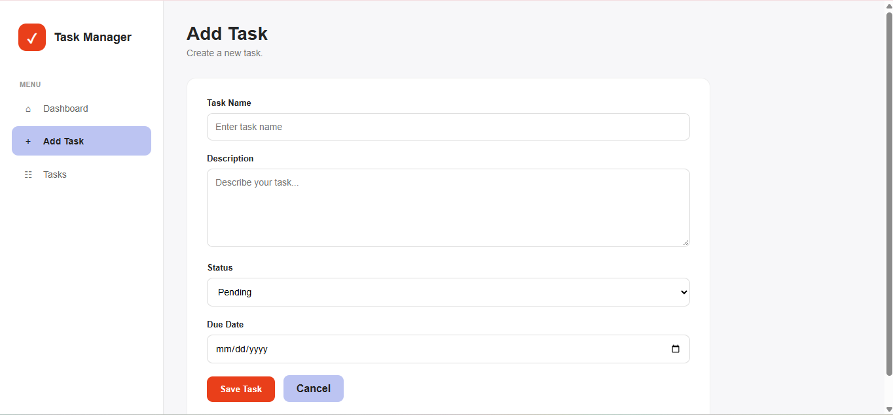
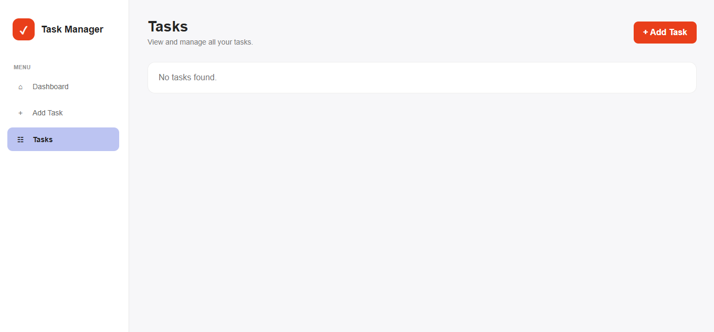
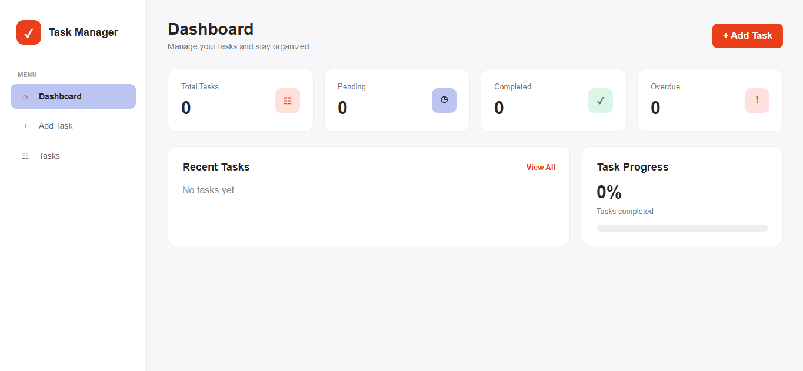

Project Code: WST21 -9:00-10:30AM-2026-MW

Student Name: TAMPUS, KLOYD CAMILO C.

Course & Year: BSIT-2/IRREG

Database Used: MYSQL

Features:
- Add Task
- View Tasks
- Edit Task
- Delete Task
- Update Status

## Screenshots

